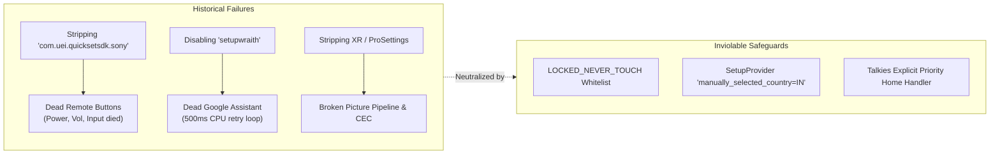

# AGENTS.md — Sony BRAVIA XR-65X90J Suite AI Agent Operational Codex

> **Audience**: Autonomous AI Coding Agents (Antigravity, Claude Code, OpenAI Codex, ChatGPT, Cursor, Gemini Code Assist, GitHub Copilot).  
> **Mandate**: This document is the authoritative, binding operational manual for navigating, extending, and maintaining the Sony BRAVIA Suite at `/home/broken/myWorld/sony_bravia_suite/`. Every AI agent operating on this codebase must adhere strictly to the contracts, safety invariants, and architectural guidelines defined herein.

---

## 1. Executive Summary & Hardware Identity

The **Sony BRAVIA Suite** is a production-grade headless control, automation, debloating, and maintenance suite designed specifically for the flagship **Sony BRAVIA XR-65X90J** 4K HDR television.

```
┌────────────────────────────────────────────────────────────────────────┐
│                   TARGET DEVICE HARDWARE IDENTITY                      │
├──────────────────────┬─────────────────────────────────────────────────┤
│ Commercial Model     │ Sony BRAVIA XR-65X90J (65" Full Array 4K LED)   │
│ Product / Chassis    │ BRAVIA_4K_VH2 / Board UR2                      │
│ Platform ID          │ BRAVIA_VH2_M_PA                                 │
│ System-on-Chip (SoC) │ MediaTek MT5895 / MT9950 (Quad Cortex-A73 1.8G) │
│ OS Version           │ Android TV 12 (Google TV)                       │
│ Build Fingerprint    │ BRAVIA_VH2_EU-user 12 STT2.230505.001.S136 682241│
│ Kernel Architecture  │ Linux 4.19.260-ab682241 (64-bit kernel)        │
│ Userspace ABI        │ 32-bit ARM (armv8l / armeabi-v7a)               │
│ Primary Launcher     │ Talkies v1.2.3 (com.techpp.glass)               │
│ Active Control Ports │ TCP 80 (WebAPI/IRCC-IP), TCP 5555 (ADB UID 2000)│
└──────────────────────┴─────────────────────────────────────────────────┘
```

---

## 2. Dual-Homed Network Topology & Failover Engine

The TV operates in a dual-network configuration to guarantee permanent headless reachability across both wireless and wired physical links.

```mermaid
flowchart TD
    subgraph HostSystem["Local Controller Host (PC)"]
        CLI["Bravia Controller / CLI"]
    end

    subgraph NetworkTopology["Dual-Homed Network Topology"]
        WIFI["Wi-Fi Primary (192.168.1.x)<br/>MAC: 38:B8:00:xx:xx:xx<br/>Deterministic Static DHCP"]
        LAN["LAN Fallback (10.42.0.x)<br/>MAC: F8:4E:17:xx:xx:xx<br/>Direct Ethernet Link"]
    end

    subgraph TV["Sony BRAVIA XR-65X90J (Android TV 12)"]
        WAPI["Sony WebAPI REST & IRCC-IP (Port 80)"]
        ADB["Elevated ADB Shell (Port 5555)"]
    end

    CLI -->|1. Fast Probe (0.35s)| WIFI
    CLI -.->|2. Failover Probe (0.35s)| LAN
    WIFI --> WAPI & ADB
    LAN --> WAPI & ADB
```

### 2.1 Network Interface Parameters
* **Primary Route — Wi-Fi (`wlan0`)**:
  - IP Address: `192.168.1.x` (configured via `SONY_TV_WIFI_IP` or `config/bravia_config.json`)
  - MAC Address: `38:B8:00:xx:xx:xx` (configured via `SONY_TV_WIFI_MAC`)
  - Gateway Binding: Local router deterministic static DHCP reservation on Wi-Fi SSID.
* **Fallback Route — Ethernet (`eth0`)**:
  - IP Address: `10.42.0.x` (configured via `SONY_TV_LAN_IP` or `config/bravia_config.json`)
  - MAC Address: `F8:4E:17:xx:xx:xx` (configured via `SONY_TV_LAN_MAC`)
  - Connection: Direct Ethernet fallback link.

### 2.2 Dynamic Endpoint Resolution Protocol
All automation tools implement dynamic endpoint probing prior to command execution:
1. **Environment Override**: If `SONY_TV_IP` or `SONY_TV_ADB` is set, prioritize it directly.
2. **Primary Wi-Fi Probe**: Attempt a non-blocking TCP socket connect to primary Wi-Fi port 80 (or 5555) with a strict **0.35-second timeout**. If reachable, select Wi-Fi.
3. **Fallback LAN Probe**: Attempt a non-blocking TCP socket connect to fallback LAN port 80 (or 5555) with a strict **0.35-second timeout**. If reachable, select LAN.
4. **Standby Default**: If neither port responds (TV in deep suspend / standby), default to Wi-Fi Primary and dispatch Wake-on-LAN.

### 2.3 Dual-MAC Multi-Broadcast Wake-on-LAN (WoL)
When the TV enters deep sleep, network interfaces downclock. The controller implements **Dual-MAC Layer-2 WoL Broadcasting**:
* Constructs magic payloads: `bytes.fromhex("FF" * 6 + MAC * 16)` for **both** Wi-Fi (WoWLAN) and LAN (WoL) MAC addresses.
* Broadcasts simultaneously across UDP port 9 to:
  - `255.255.255.255` (Global Layer-2 Broadcast)
  - Primary Wi-Fi Subnet Broadcast
  - Fallback LAN Subnet Broadcast

---

## 3. Inviolable Whitelist & Protected Subsystems

Previous aggressive debloating passes on this specific chassis led to severe hardware regressions. AI agents must understand **why** these subsystems broke and **never** attempt to disable, uninstall, or modify the protected components.



### 3.1 Why Remote Buttons Must Never Be Broken Again
* **Root Cause Package**: `com.uei.quicksetsdk.sony` (Universal Electronics QuickSet SDK for Sony BRAVIA) and `com.sony.dtv.usercontext`.
* **Hardware Interconnect**: The Sony physical remote (`SONY TV VRC 001`) communicates via dual interfaces: Bluetooth Low Energy (`/dev/input/event4`) and Infrared (`/dev/input/event1`).
* **Proprietary Failure Mechanism**: MediaTek Linux kernel input drivers (`mtkinp_ir_events`) do not pass raw key events directly to applications. Sony implements a proprietary abstraction layer: `com.uei.quicksetsdk.sony` receives raw remote events, translates them through Sony's `PhoneWindowManager` hooks, maps keycodes for external HDMI-CEC devices, and routes volume/input commands.
* **Invariant**: **NEVER disable, uninstall, or hide `com.uei.quicksetsdk.sony` or `com.sony.dtv.usercontext`**.

### 3.2 Why Google Assistant Must Never Be Broken Again
* **Root Cause Package**: `com.google.android.tungsten.setupwraith`.
* **Proprietary Failure Mechanism**:
  1. **Infinite Query Spin**: Decompilation of `SonySystemService.apk` (`SetupProviderGateway.kt`) revealed that Sony's internal `CountrySettingsModule` continuously polls `content://com.google.android.tungsten.setupwraith/setup_provider` every 500ms for column `manually_selected_country`. If `setupwraith` is disabled or this row is empty, the thread hangs in an infinite retry spin, starving background threads and preventing voice initialization.
  2. **Service Type Mismatch**: Google Assistant (`com.google.android.katniss`) requires the system setting `secure voice_recognition_service` to explicitly point to `com.google.android.katniss/com.google.android.apps.tvsearch.voice.recognition.KatnissRecognitionService`. Setting this to `KatnissVoiceInteractionService` causes immediate service rejection with mic error `F80`.
  3. **Setup Completion Flags**: Android TV requires `setup_wizard_has_run=1`, `device_provisioned=1`, `user_setup_complete=1`, and `tv_user_setup_complete=1`.
* **Invariant**: **NEVER disable `com.google.android.tungsten.setupwraith` or clear `setup_provider`**.

### 3.3 The Immutable Protected Whitelist (LOCKED_NEVER_TOUCH)

The following 18 packages are hard-locked in [`bin/sony_clean_slate_talkies.py`](file:///home/broken/myWorld/sony_bravia_suite/bin/sony_clean_slate_talkies.py). Any script or agent touching these will trigger a hard security abort:

| # | Package Identifier | Subsystem Role & Hardware Dependency |
| :-: | :--- | :--- |
| 1 | `com.uei.quicksetsdk.sony` | **CRITICAL**: Universal Electronics remote hardware translation layer |
| 2 | `com.sony.dtv.usercontext` | **CRITICAL**: Remote button user context & global event dispatching |
| 3 | `com.sony.dtv.remotecontrolsettings` | Remote pairing and IR/BLE settings provider |
| 4 | `com.google.android.tungsten.setupwraith` | **CRITICAL**: SetupProvider required by Katniss & SonySystemService |
| 5 | `com.google.android.katniss` | Google Assistant core voice search & speech recognition engine |
| 6 | `com.google.android.katniss.search` | Katniss search integration provider |
| 7 | `com.google.android.tts` | Google Text-To-Speech speech synthesis engine |
| 8 | `com.google.android.voicesearch` | System voice search intent receiver |
| 9 | `com.sony.dtv.b2b.hotelsettings` | Hosts Pre-Shared Key (PSK) ContentProvider for IP control |
| 10 | `com.sony.dtv.b2b.prosettings` | Cognitive Processor XR picture tuning, Pro mode, IPC |
| 11 | `com.sony.dtv.b2b.ipcontrolsettings` | IP control authorization provider (`/sony/accessControl`) |
| 12 | `com.sony.dtv.webapi.core` | Sony WebAPI REST (port 80) & IRCC-IP proxy daemon |
| 13 | `com.sony.dtv.videoframeserver` | Master Cognitive Processor XR video processing engine |
| 14 | `com.sony.dtv.sonysystemservice` | Picture mode controller, light sensor, ambient processing |
| 15 | `com.sony.dtv.audiooutput` | Master audio HAL routing & eARC soundbar handshakes |
| 16 | `com.sony.dtv.audiosysteminfoprovider`| eARC/ARC soundbar handshake provider |
| 17 | `com.sony.dtv.tvinput.external` | HDMI 1-4 input switching and CEC device control |
| 18 | `com.techpp.glass` | **Talkies v1.2.3** primary leanback home launcher |

---

## 4. Repository Structure & Tooling Architecture

```
/home/broken/myWorld/sony_bravia_suite/
├── AGENTS.md                          # Master AI agent operational codex (this file)
├── README.md                          # Human operations manual & quickstart guide
├── .gitignore                         # Strict exclusion of live secrets and caches
├── .env.example                       # Template for environment configuration
├── bin/                               # Tooling and CLI executables
│   ├── manage.sh                      # Single-entry management wrapper CLI
│   ├── bravia                         # Symlink to sony_bravia_controller.py
│   ├── sony_bravia_controller.py      # Master JSON-RPC 2.0 REST & IRCC-IP client
│   ├── sony_clean_slate_talkies.py    # Multi-threaded clean-slate optimizer & launcher pin
│   ├── restore_stock_sony.py          # 100% factory package restoration engine
│   └── sanitize_audit.py              # Automated secret scanner (exit 0 on clean)
├── config/                            # Configuration files and templates
│   ├── bravia_config.example.json     # Sanitized configuration template
│   ├── cookies.example.txt            # Sanitized Netscape auth cookie template
│   ├── bravia_config.json             # Live local configuration (UNTRACKED)
│   └── cookies.txt                    # Live session auth cookie (UNTRACKED)
├── backups/                           # Package manifests and baseline ledgers
│   ├── disabled_packages.txt          # Safe-to-disable non-critical packages
│   └── stock_packages_baseline.txt    # Complete 100% stock OEM package inventory (260 pkgs)
└── docs/                              # In-depth forensic specifications
    ├── cleanup_risks_and_dependencies.md # Decompilation post-mortem & dependency maps
    ├── keycodes_and_protocols.md      # IRCC hex/base64 codes, REST endpoints, keyevents
    └── sony_tv_end_to_end_analysis.md # 30KB forensic audit (SoC, AVB 2.0, port scan)
```

### 4.1 Tool Inventory & Responsibilities
* **[`bin/manage.sh`](file:///home/broken/myWorld/sony_bravia_suite/bin/manage.sh)**: High-level frontend wrapper with pre-checks, dynamic IP resolution, and command dispatch (`status`, `power`, `clean`, `check`, `restore`, `shell`).
* **[`bin/bravia`](file:///home/broken/myWorld/sony_bravia_suite/bin/bravia)** & **[`bin/sony_bravia_controller.py`](file:///home/broken/myWorld/sony_bravia_suite/bin/sony_bravia_controller.py)**: Headless IP controller implementing JSON-RPC 2.0 (`/sony/system`, `/sony/audio`, `/sony/avContent`, `/sony/accessControl`) and IRCC SOAP over port 80. Manages file locks, cookie refresh, dual-MAC WoL, and discrete remote keycodes.
* **[`bin/sony_clean_slate_talkies.py`](file:///home/broken/myWorld/sony_bravia_suite/bin/sony_clean_slate_talkies.py)**: Multi-threaded (`ThreadPoolExecutor`) optimizer. Executes pre-flight assertions, pins Talkies v1.2.3 as default home activity, disables verified safe bloatware across Tiers 1–6, trims caches, and runs post-verification.
* **[`bin/restore_stock_sony.py`](file:///home/broken/myWorld/sony_bravia_suite/bin/restore_stock_sony.py)**: 100% factory restore script. Concurrently reinstalls uninstalled packages via `cmd package install-existing --user 0`, unhides and enables disabled packages, and resets AppOps without wiping user data or logins.
* **[`bin/sanitize_audit.py`](file:///home/broken/myWorld/sony_bravia_suite/bin/sanitize_audit.py)**: Fast automated secret scanner that scans repository files for leaked PSKs, real auth cookies, serial numbers, and router passwords.

### 4.2 Architectural Split: When to Use WebAPI vs. ADB

Agents must understand the strict functional boundary between the two control protocols:

| Domain | Protocol Used | Technical Rationale |
| :--- | :---: | :--- |
| **Power On / Wakeup** | **WebAPI / Dual-MAC WoL** | `adbd` is dead during TV deep standby. Only hardware WoL + port 80 wake cold hardware. |
| **Volume Control** | **WebAPI JSON-RPC** | Deterministic (`setAudioVolume 18`). ADB keyevent 24/25 is blind and cannot set exact volume. |
| **Input Switching** | **WebAPI REST** | Direct switching (`extInput:hdmi?port=1`). ADB `keyevent 178` pops up intrusive on-screen menus. |
| **Discrete Remote Keys** | **IRCC-IP SOAP** | Direct C++ socket (<10ms). ADB `input keyevent` spawns a heavy JVM (`app_process`, 150-300ms) causing video frame drops. |
| **Package Management** | **ADB UID 2000** | WebAPI cannot install, disable, or unhide system packages (`pm disable-user`, `cmd package`). |
| **Launcher Pinning** | **ADB UID 2000** | WebAPI cannot manipulate Android's `ActivityTaskManager` default home handler. |
| **Cache & OS Limits** | **ADB UID 2000** | System-level `pm trim-caches` and `device_config` require shell privileges. |

---

## 5. Execution Contracts & Concurrency Rules

### 5.1 Multi-Threading Requirements (`ThreadPoolExecutor`)
* Batch ADB operations (package disabling, package reinstalls, AppOps resets) **MUST** use `concurrent.futures.ThreadPoolExecutor(max_workers=8)` to avoid multi-minute serial latency.
* Individual worker functions must be stateless and handle return codes safely without crashing the pool.

### 5.2 Concurrency & Process Synchronization
* [`bin/sony_bravia_controller.py`](file:///home/broken/myWorld/sony_bravia_suite/bin/sony_bravia_controller.py) uses exclusive file locking on `/tmp/sony_bravia_controller.lock` via `fcntl.flock(lock_fd, fcntl.LOCK_EX)` during WebAuth cookie write/refresh operations.
* Agents must not circumvent or remove file locks.

### 5.3 Talkies Launcher Home Pinning Contract
* Talkies v1.2.3 (`com.techpp.glass`) is pinned using:
  ```bash
  adb shell cmd package set-home-activity com.techpp.glass/.HomeActivity
  ```
* Google TV LauncherX (`com.google.android.apps.tv.launcherx`) should normally remain enabled in the background as a dormant safety fallback unless `--disable-launcherx` is explicitly requested by the user.

---

## 6. Safe Testing & AI Agent Operational Protocols

When modifying or testing scripts in this suite, AI agents must adhere to the following safety protocols:

### 6.1 Non-Destructive Testing Rules
1. **Never Interrupt Streaming**: Do NOT execute reboot commands (`manage.sh power reboot`, `bravia key PowerOff`) or disable active media applications (`org.smarttube.beta`, `com.netflix.ninja`, `in.startv.hotstar`, `com.amazon.amazonvideo.livingroom`, `org.videolan.vlc`) without explicit user permission.
2. **Read-Only Probes First**: Always verify connectivity using non-mutating status probes:
   ```bash
   ./bin/manage.sh status
   ./bin/bravia status
   ./bin/manage.sh check
   ```
3. **Safe Volume Testing**: Test audio control using minimal, non-disruptive steps:
   ```bash
   ./bin/bravia volume step +1
   ./bin/bravia volume step -1
   ```
4. **Never Touch System Settings Out of Bounds**: Do not modify global or secure settings outside of documented Assistant and setup completion keys (`voice_recognition_service`, `setup_wizard_has_run`, etc.).

---

## 7. Secret Hygiene & Configuration Protocol

Security and privacy hygiene are mandatory for this repository.

### 7.1 Environment Variables
The suite supports configuration via environment variables, loaded in order of priority:
* `SONY_TV_IP`: Overrides dynamic IP resolution for both REST and ADB.
* `SONY_TV_WIFI_IP`: Sets primary Wi-Fi IP (default: `192.168.1.100`).
* `SONY_TV_LAN_IP`: Sets fallback LAN IP (default: `10.42.0.100`).
* `SONY_TV_WIFI_MAC`: Sets Wi-Fi MAC address (default: `38:B8:00:XX:XX:XX`).
* `SONY_TV_LAN_MAC`: Sets LAN MAC address (default: `F8:4E:17:XX:XX:XX`).
* `SONY_TV_PSK`: Pre-Shared Key for port 80 WebAPI access (e.g. `X-Auth-PSK`).
* `SONY_TV_COOKIE_FILE`: Explicit path to authenticated Netscape cookie jar.
* `SONY_TV_ADB`: ADB target in `host:port` format (e.g. `192.168.1.100:5555`).

### 7.2 Untracked Secret Files
The following files contain live device secrets and **MUST NEVER** be committed to Git:
* `config/bravia_config.json`: Live device configuration (contains live PSK, serial).
* `config/cookies.txt` and `sony_bravia_cookies.txt`: Live authenticated session tokens.
* `.env` and `*.env`: Local environment secret definitions.
* `local_config.json`: Local override files.

### 7.3 Sanitized Configuration Templates
Commit only template files with placeholder strings:
* [`config/bravia_config.example.json`](file:///home/broken/myWorld/sony_bravia_suite/config/bravia_config.example.json)
* [`config/cookies.example.txt`](file:///home/broken/myWorld/sony_bravia_suite/config/cookies.example.txt)
* [`.env.example`](file:///home/broken/myWorld/sony_bravia_suite/.env.example)

### 7.4 Pre-Commit Sanitization Audit
Before committing any changes or declaring a task complete, run the automated secret scanner:
```bash
./bin/sanitize_audit.py
```
If the script exits with non-zero (exit code 1), fix any detected leaks before proceeding.
