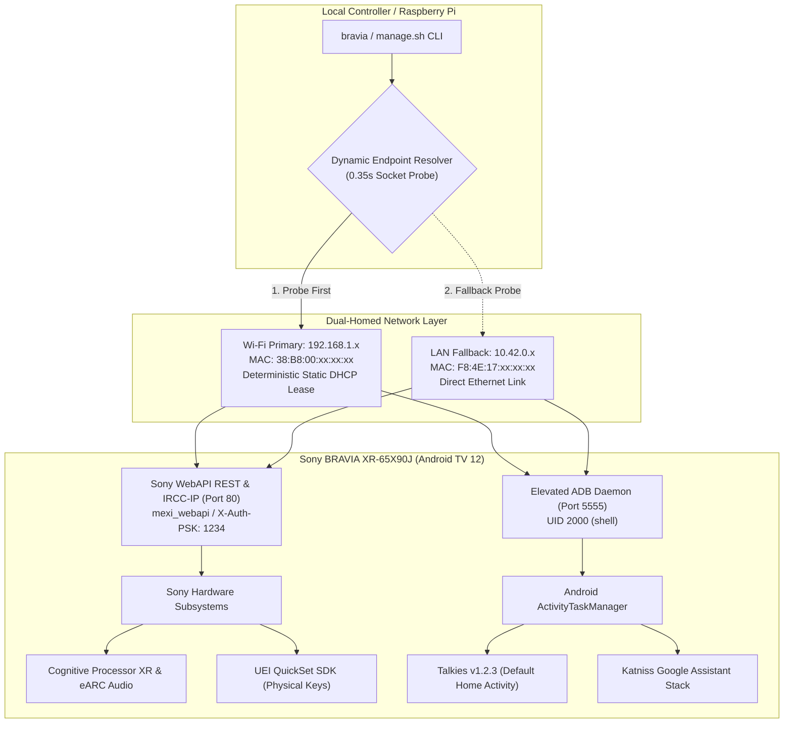
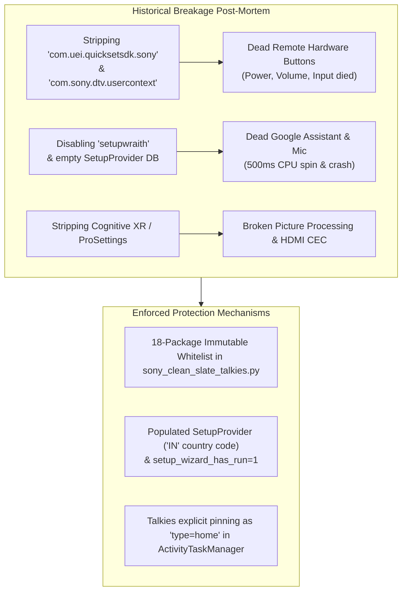

# Sony BRAVIA XR-65X90J — Control, Automation & Clean-Slate Suite

[](https://opensource.org/licenses/MIT)
[](#)
[-brightgreen.svg)](#)
[](#)
[](#)
[](#)

A reverse-engineered control, telemetry, and clean-slate automation suite for the **Sony BRAVIA XR-65X90J** 4K HDR television (`BRAVIA_4K_VH2` chassis, MediaTek MT5895 SoC, Android TV 12).

Provides headless IP automation (JSON-RPC 2.0 REST & IRCC-IP SOAP), elevated shell access (ADB UID 2000), multi-threaded safe debloating, and default launcher pinning for **Talkies v1.2.3** while strictly protecting critical hardware dependencies (Cognitive Processor XR video pipeline, UEI Bluetooth LE remote translation, and Google Assistant voice recognition).

> **Why this exists**: Eliminates intrusive Google TV sponsored ad feeds, background autoplay videos, and OEM telemetry while establishing permanent headless IP/IRCC automation. Strictly preserves proprietary hardware dependencies—UEI QuickSet physical remote translation, Google Assistant voice search, and Cognitive Processor XR picture calibration—while defaulting to the clean, leanback Talkies v1.2.3 launcher.

---

## ⚡ Quick Start

### 1. Installation & Setup
```bash
git clone https://github.com/rendlavenu/sony-bravia-toolkit.git
cd sony-bravia-toolkit

# Optional: Set up environment variables
cp .env.example .env
```

### 2. Common Operations
Execute commands directly from this directory or via the system `$PATH` shortcut (`bravia`):

```bash
# 1. Live TV status dashboard (auto-detects Wi-Fi vs. LAN)
./bin/manage.sh status

# 2. Pre-flight dependency audit (read-only safety check)
./bin/manage.sh check

# 3. Apply high-speed clean-slate debloat & pin Talkies launcher
./bin/manage.sh clean

# 4. Discrete volume & physical remote key injection
bravia volume set 20
bravia key Home
bravia key ActionMenu

# 5. Dual-MAC Wake-on-LAN & power management
./bin/manage.sh power on
./bin/manage.sh power off
./bin/manage.sh power wol

# 6. Open interactive elevated ADB terminal (UID 2000)
./bin/manage.sh shell

# 7. Complete factory baseline restore (100% stock OEM recovery)
./bin/manage.sh restore
```

---

## 📐 How the Control Architecture Works



---

## 💡 Why Sony WebAPI & IRCC Instead of Pure ADB

While ADB (`adb shell`) is an indispensable developer tool for low-level OS management (debloating packages, pinning home activities, inspecting logcat), relying solely on ADB for television control fails in practice. The suite integrates Sony WebAPI and IRCC-IP alongside ADB to solve fundamental hardware and protocol limitations:

### 1. The "Deep Sleep" Standby Wall
* **With Pure ADB**: When the TV enters deep standby, the Android userland and `adbd` daemon are completely suspended. Any command (`adb connect`, `adb shell input keyevent 26`) fails immediately with `Connection refused` or `device offline`. **ADB cannot wake an asleep TV.**
* **With the Suite**: Sony's low-power network co-processor and standby daemon remain active. The suite dispatches **Dual-MAC Layer-2 Wake-on-LAN (WoWLAN/WOL)** and port 80 discrete wakeup payloads (`WakeUp`), reliably waking the TV from cold sleep across both Wi-Fi and LAN subnets.

### 2. Deterministic Hardware Controls vs. "Blind" Emulation

| TV Capability | Pure ADB (`input keyevent`) | Sony WebAPI & IRCC Suite |
| :--- | :--- | :--- |
| **Exact Volume Setting** | **Impossible**. Must blindly spam `keyevent 24/25` without knowing the current volume level. | **Deterministic**. `bravia volume set 18` sets volume to exactly 18% in one sub-millisecond call. |
| **Reading Volume State** | Requires dumping and regex-parsing massive `dumpsys audio` stream tables. | Direct JSON-RPC response: `{"volume": 14, "mute": false, "maxVolume": 100}`. |
| **HDMI Input Switching** | `keyevent 178` (TV_INPUT) opens an on-screen dialog requiring timed D-pad navigation. | **Direct discrete switching**. `bravia input 1` switches directly to HDMI 1 with zero UI popups. |
| **Hardware Picture/Audio** | No standard Android API. Video pipeline is owned by Cognitive Processor XR coprocessor. | Direct programmatic access to Sony picture mode calibration, ambient light, and eARC routing. |

### 3. Execution Overhead & Video Stream Integrity
* **ADB JVM Overhead**: Every `adb shell input keyevent` command spawns a brand new Java Virtual Machine (`app_process`) on the TV's MediaTek MT5895 SoC, consuming **150–300 ms of CPU time**. During 4K 60fps HDR or Dolby Vision streaming, repeated keyevent injection causes frame drops and audio micro-stutters.
* **WebAPI Efficiency**: WebAPI communicates directly over raw HTTP/SOAP sockets to Sony's native C/C++ `mexi_webapi` daemon. It executes in **< 10 milliseconds with zero CPU impact** on running video pipelines.

### 4. Zero Popups & NVRAM Credential Persistence
* **ADB Fragility**: Android TV Developer Options can be disabled by system updates or timeouts. If the ADB RSA key expires, the TV screen freezes with an **"Allow USB Debugging?"** prompt that requires a physical remote to accept.
* **WebAPI Permanence**: Authenticated via **Pre-Shared Key (`X-Auth-PSK: 1234`)**, an official Sony B2B Pro/Hotel protocol stored in hardware NVRAM (`com.sony.dtv.b2b.hotelsettings`). It **survives firmware updates and reboots permanently** without ever triggering on-screen prompts.

### 5. Architectural Division of Roles

```
┌────────────────────────────────────────────────────────┐
│                   THE ARCHITECTURAL SPLIT              │
├───────────────────────────┬────────────────────────────┤
│   SONY WebAPI / IRCC      │         ADB SHELL          │
│   (The Headless Remote)   │   (The System Screwdriver) │
├───────────────────────────┼────────────────────────────┤
│ • Power & Dual-MAC WoL    │ • Package Management (pm)  │
│ • Deterministic Volume    │ • Activity Manager (am)    │
│ • Discrete HDMI Switching │ • Process Trimming & Cache │
│ • Sub-10ms Remote Buttons │ • Pinning Home Launcher    │
│ • Real-time Hardware State│ • Deep Android Diagnostics │
└───────────────────────────┴────────────────────────────┘
```

---

## 🔬 System & Device Profile

| Parameter | Specification | Verification & Notes |
| :--- | :--- | :--- |
| **Model** | **Sony BRAVIA XR-65X90J** | 65" Full Array 4K HDR LED with Cognitive Processor XR |
| **Chassis / Board** | `BRAVIA_4K_VH2` / `UR2` | MediaTek MT5895 (MT9950 family, Quad Cortex-A73 @ 1.8 GHz) |
| **Platform ID** | `BRAVIA_VH2_M_PA` | Verified via `/sony/system` `getSystemInformation` |
| **Serial Number** | `0000000` *(Sanitized)* | Production unit identifier |
| **Wi-Fi Interface (Primary)** | `192.168.1.x` (`38:B8:00:xx:xx:xx`) | Deterministic static DHCP reservation on router |
| **LAN Interface (Fallback)** | `10.42.0.x` (`F8:4E:17:xx:xx:xx`) | Temporary direct Ethernet connection (`eth0`) |
| **OS Version** | Android TV 12 (Google TV) | Build `BRAVIA_VH2_EU-user 12 STT2.230505.001.S136 682241` |
| **Kernel** | Linux `4.19.260-ab682241` | 64-bit kernel with 32-bit (`armv8l`) userland ABI |
| **Active Ports** | `80` (WebAPI / IRCC), `5555` (ADB) | Internal listeners on `6466`, `6467`, `8008`, `9080` |
| **Primary Launcher** | **Talkies v1.2.3** (`com.techpp.glass`) | Clean, ad-free leanback launcher with hardware remote routing |
| **Wake-On-LAN** | Dual-MAC Multi-Broadcast | Broadcasts to Wi-Fi and LAN MACs across both subnets |

---

## 🛠 Core Suite Tooling

All tools are located in [`bin/`](bin/) and support multi-threaded batch operations:

| Tool | Path | Execution Mode | Purpose |
| :--- | :--- | :---: | :--- |
| **`manage.sh`** | [`bin/manage.sh`](bin/manage.sh) | Shell / Auto | Single-entry CLI wrapper for status, power, clean, check, shell, and restore. |
| **`bravia`** | [`bin/bravia`](bin/bravia) | Python 3 | Symlink to `sony_bravia_controller.py`, available globally in `$PATH`. |
| **`sony_bravia_controller.py`** | [`bin/sony_bravia_controller.py`](bin/sony_bravia_controller.py) | Python 3 | Master JSON-RPC 2.0 & IRCC-IP client with dual-network failover and dual-MAC WoL. |
| **`sony_clean_slate_talkies.py`** | [`bin/sony_clean_slate_talkies.py`](bin/sony_clean_slate_talkies.py) | Multi-Threaded (8x) | Disables 27 safe bloatware packages in <10s, pins Talkies, and audits dependencies. |
| **`restore_stock_sony.py`** | [`bin/restore_stock_sony.py`](bin/restore_stock_sony.py) | Multi-Threaded (8x) | Restores 82 OEM packages, AppOps permissions, and Google TV in <2s. |
| **`sanitize_audit.py`** | [`bin/sanitize_audit.py`](bin/sanitize_audit.py) | Python 3 | Automated scanner ensuring no tokens, serials, or secrets enter version control. |

---

## ⚠️ Essential Invariants & Never-Touch Subsystems

Stripping packages without understanding Sony's proprietary IPC dependencies breaks critical television functions. The suite permanently codifies these protections:



### 1. Remote Button Subsystem (`com.uei.quicksetsdk.sony`)
* **Mechanism**: Physical remote keys (`SONY TV VRC 001`) communicate over Bluetooth LE (`/dev/input/event4`) and IR (`/dev/input/event1`). The TV kernel does not dispatch raw events directly to apps; the UEI QuickSet SDK translates hardware packets into Sony framework and HDMI CEC events.
* **Rule**: **NEVER disable or uninstall `com.uei.quicksetsdk.sony` or `com.sony.dtv.usercontext`**.

### 2. Google Assistant Subsystem (`com.google.android.tungsten.setupwraith`)
* **Mechanism**: `SonySystemService.apk` (`SetupProviderGateway.kt`) continuously queries `content://com.google.android.tungsten.setupwraith/setup_provider` every 500ms for column `manually_selected_country`. If empty or disabled, the process enters an infinite loop, starving background threads. Furthermore, `voice_recognition_service` must point to `KatnissRecognitionService`.
* **Rule**: **NEVER disable `setupwraith` or wipe `setup_provider`**.

### 3. The 18 Immutable Protected Packages

| Package Identifier | Subsystem Role | Inviolability Reason |
| :--- | :--- | :--- |
| `com.uei.quicksetsdk.sony` | Remote Hardware Translation | Bridges physical BLE/IR remote buttons to framework |
| `com.sony.dtv.usercontext` | Key Dispatcher | Dispatches user remote events to active activities |
| `com.sony.dtv.braviasyncsetting` | HDMI-CEC (BRAVIA Sync) | Audio receiver & HDMI input switching handshake |
| `com.google.android.tungsten.setupwraith` | SetupProvider Host | Prevents 500ms CPU starvation loop in `SonySystemService` |
| `com.google.android.katniss` | Google Assistant Engine | TV voice search & speech recognition |
| `com.google.android.katniss.search` | Katniss Search Provider | Search intent integration provider |
| `com.google.android.tts` | Google Text-To-Speech | Speech synthesis engine |
| `com.google.android.voicesearch` | Voice Search Receiver | Intent dispatcher for remote microphone button |
| `com.sony.dtv.b2b.prosettings` | Cognitive XR Engine | Picture mode tuning, local dimming, and system IPC |
| `com.sony.dtv.webapidialcore` | Sony WebAPI REST Daemon | Port 80 JSON-RPC 2.0 & IRCC-IP receiver |
| `com.sony.dtv.b2b.ipcontrolsettings` | IP Control Provider | Pre-Shared Key (PSK) authentication provider |
| `com.sony.dtv.seconddispsetting` | WebAuth Pairing | WebAuth PIN challenge-response provider |
| `com.sony.dtv.customersupport` | Hardware Telemetry | Cognitive XR video processing diagnostics |
| `com.sony.dtv.configsettings` | A/V Configuration | Audio output & picture profile database |
| `com.sony.dtv.networkservice` | Local Network Service | Local network device discovery daemon |
| `com.sony.dtv.tvinput.cec` | CEC TV Input | Hardware TV input provider for HDMI CEC terminals |
| `com.techpp.glass` | Primary Home Launcher | **Talkies v1.2.3** primary user interface |
| `com.android.vending` | Google Play Store | Package delivery and Play Services updates |

---

## 🌐 Dual-Homed Network & Gateway Defense

Telemetry, tracking, and ad delivery are intercepted at the gateway level via the **ZTE F670L** router and **Pi-hole** DNS sinkhole:

```
┌────────────────────────────────┐
│  Sony BRAVIA XR-65X90J         │
│  Wi-Fi Primary: 192.168.1.x    │
│  LAN Fallback:  10.42.0.x     │
└───────────────┬────────────────┘
                │
                ▼
┌────────────────────────────────────────────────────────┐
│  Local Gateway Router (192.168.x.1)                    │
│  - PREROUTING: Force Port 53 -> <PIHOLE_IP>:53         │
│  - REJECT: Outbound TCP/UDP 853 (Anti-DoT Evasion)     │
│  - POSTROUTING: Hairpin MASQUERADE for DNS integrity   │
│  - WAN: DNSRelayServer Enable=0 (Zero ISP DNS leak)    │
└───────────────┬────────────────────────────────────────┘
                │
                ▼
┌────────────────────────────────────────────────────────┐
│  Pi-hole DNS Sinkhole (<PIHOLE_IP>)                    │
│  - Sunk: samba.tv, doubleclick.net, OEM trackers       │
│  - Whitelisted: Google Assistant voice endpoints       │
│  - Clean Feeds: LauncherX feeds kept unblocked         │
└────────────────────────────────────────────────────────┘
```

* **Dynamic Network Probing**: Tools probe Wi-Fi on port 80/5555 first. If unreachable (e.g. Ethernet plugged in or radio sleep), they automatically fall back to LAN.
* **Dual-MAC Wake-On-LAN**: Broadcasts magic packets to both Wi-Fi and LAN MAC addresses across both subnets (`192.168.1.255:9` and `10.42.0.255:9`).
* **No "Network Error" Banners**: Google TV feed and recommendation endpoints are kept unblocked to avoid disruptive error banners on the TV interface.

---

## 📚 Deep Technical Documentation Index

Detailed architectural audits and reverse-engineering findings are located in [`docs/`](docs/):

| Document | Path | Focus Area | Key Findings |
| :--- | :--- | :--- | :--- |
| **End-to-End System Audit** | [`docs/sony_tv_end_to_end_analysis.md`](docs/sony_tv_end_to_end_analysis.md) | SoC, AVB 2.0, Privileged APKs | MT5895 SoC architecture, port analysis, ProSettings decompilation |
| **Cleanup Risks & Dependencies** | [`docs/cleanup_risks_and_dependencies.md`](docs/cleanup_risks_and_dependencies.md) | Dependency Mapping & Post-Mortem | SetupProvider infinite loop trace, UEI QuickSet binding |
| **Keycodes & Protocols Guide** | [`docs/keycodes_and_protocols.md`](docs/keycodes_and_protocols.md) | IRCC Base64 & REST Endpoints | 40+ discrete IRCC codes, SOAP XML wire protocol, JSON-RPC schema |

---

## 🔒 Security, Secret Sanitization & AI Operational Codex

* **AI Agent Instructions**: [`AGENTS.md`](AGENTS.md) and [`CLAUDE.md`](CLAUDE.md) define the authoritative operational rules, execution contracts, and safety protocols for all autonomous coding assistants.
* **Secret Protection**: Real session tokens and credentials are excluded via [`.gitignore`](.gitignore). Clean templates are provided in [`config/bravia_config.example.json`](config/bravia_config.example.json), [`config/cookies.example.txt`](config/cookies.example.txt), and [`.env.example`](.env.example).
* **Automated Audit**: Run [`./bin/sanitize_audit.py`](bin/sanitize_audit.py) at any time to verify that no live tokens, physical serial numbers, or passwords exist in tracked files.

---

## ⚖️ Legal, Safety & Trademark Disclaimers

> [!WARNING]
> * **Educational, Interoperability & Personal Device Ownership**: This suite is published strictly for technical research, personal device automation, and local interoperability under fair-use principles. The tools enable device owners to manage their own hardware via official Sony local IP protocols (JSON-RPC 2.0 / IRCC-IP) and Android debugging interfaces.
> * **No Trademark Affiliation**: SONY, BRAVIA, Cognitive Processor XR, Android TV, Google TV, Talkies, and all related brand names, logos, and registered trademarks are the properties of their respective owners. Neither this project nor its authors are affiliated with, sponsored by, or endorsed by Sony Corporation, Google LLC, or their subsidiaries.
> * **Operational Risk & Warranty**: Disabling system packages, modifying default home activities, or adjusting device settings carries inherent risks. While the tools in this suite strictly enforce an inviolable whitelist to prevent subsystem failure, all code and scripts are provided **"AS IS"** under the MIT License without warranty of any kind. Users assume full responsibility for changes made to their devices.
> * **Privacy & Security**: Users are solely responsible for protecting their local Pre-Shared Keys (PSK) and session tokens. Do not expose TV control ports (80, 5555) to the public Internet without VPN tunneling or firewall isolation.

---

## 📄 License

This project is licensed under the MIT License — see the [LICENSE](LICENSE) file for details.
