# Sony BRAVIA XR-65X90J — Keycodes, Protocols & API Reference Guide

**Device Target**: Sony BRAVIA XR-65X90J (`BRAVIA_4K_VH2`, MediaTek MT5895 / MT9950, Android TV 12)  
**Hardware Remote**: SONY TV VRC 001 (Bluetooth Low Energy & IR)  
**Input Nodes**: `/dev/input/event4` (BLE remote) & `/dev/input/event1` (`mtkinp_ir_events`)  
**Network Endpoints**: `http://<TV_WIFI_IP>:80` [Wi-Fi Primary] / `http://<TV_LAN_IP>:80` [LAN Fallback] (WebAPI & IRCC-IP), Port 5555 (ADB elevated shell)

---

## 1. Overview & Protocol Architecture

Control of the Sony BRAVIA XR-65X90J operates across three distinct architectural layers:

```mermaid
flowchart TD
    subgraph Layer1["Physical & BLE Remote Input"]
        R1["SONY TV VRC 001 Remote"] -->|BLE / IR| EV["/dev/input/event4 & event1"]
        EV -->|Kernel Scancodes| UEI["com.uei.quicksetsdk.sony & services.jar"]
        UEI -->|AOSP Keycodes| AT["ActivityTaskManager / WindowManager"]
    end

    subgraph Layer2["Local IP REST & IRCC-IP (Port 80)"]
        CLI["sony_bravia_controller.py / bravia CLI"] -->|HTTP POST JSON-RPC 2.0| NGINX["Nginx Proxy / mexi_webapi.sock"]
        CLI -->|HTTP POST SOAP XML| IRCC["/sony/ircc (IRCC-IP)"]
        NGINX --> SVC["WebApiDialCore Privileged Subsystem"]
    end

    subgraph Layer3["Elevated Shell (Port 5555)"]
        ADB["ADB Shell (UID 2000)"] -->|input keyevent / am / pm| OS["Android TV 12 Framework"]
    end
```



---

## 2. Discrete IRCC-IP Hex & Base64 Master Codes

Sony BRAVIA IRCC-IP (Infra-Red Compatible Control over IP) operates via HTTP POST requests to `http://<TV_IP>/sony/ircc`.

### 2.1 Wire Protocol & SOAP Envelope
* **HTTP Method**: `POST`
* **Target URL**: `http://<TV_IP>/sony/ircc`
* **Required Headers**:
  - `Content-Type: text/xml; charset=UTF-8`
  - `SOAPACTION: "urn:schemas-sony-com:service:IRCC:1#X_SendIRCC"`
  - `X-Auth-PSK: <YOUR_PSK>` *(or authenticated session cookie `auth=...`)*
* **SOAP XML Payload Structure**:
  ```xml
  <?xml version="1.0" encoding="utf-8"?>
  <s:Envelope xmlns:s="http://schemas.xmlsoap.org/soap/envelope/" s:encodingStyle="http://schemas.xmlsoap.org/soap/encoding/">
    <s:Body>
      <u:X_SendIRCC xmlns:u="urn:schemas-sony-com:service:IRCC:1">
        <IRCCCode>AAAAAQAAAAEAAABgAw==</IRCCCode>
      </u:X_SendIRCC>
    </s:Body>
  </s:Envelope>
  ```

### 2.2 Binary Wire Encoding Format
Sony IRCC codes are 13-byte binary payloads encoded in Base64:
`[ControlCode: 2B] [FormatCode: 2B] [CategoryCode: 4B] [DataCode: 4B] [FrameSetting: 1B]`
* The standard prefix `AAAAAQAAAAEAAAA=` translates to `00 00 00 01 00 00 00 01 00 00 00`.
* The trailing byte `Aw==` (`0x03`) signifies frame termination.

### 2.3 Master IRCC Code Registry

| Function | Command Name | IRCC Base64 Code | Raw 13-Byte Hex Payload |
| :--- | :--- | :--- | :--- |
| **Power On (Discrete)** | `WakeUp` | `AAAAAQAAAAEAAAAuAw==` | `00 00 00 01 00 00 00 01 00 00 00 2e 03` |
| **Power Off (Discrete)** | `PowerOff` | `AAAAAQAAAAEAAAAvAw==` | `00 00 00 01 00 00 00 01 00 00 00 2f 03` |
| **Toggle Power** | `TvPower` | `AAAAAQAAAAEAAAAVAw==` | `00 00 00 01 00 00 00 01 00 00 00 15 03` |
| **Sleep** | `Sleep` | `AAAAAQAAAAEAAAAvAw==` | `00 00 00 01 00 00 00 01 00 00 00 2f 03` |
| **Sleep Timer** | `SleepTimer` | `AAAAAQAAAAEAAAA2Aw==` | `00 00 00 01 00 00 00 01 00 00 00 36 03` |
| **Volume Up** | `VolumeUp` | `AAAAAQAAAAEAAAASAw==` | `00 00 00 01 00 00 00 01 00 00 00 12 03` |
| **Volume Down** | `VolumeDown` | `AAAAAQAAAAEAAAATAw==` | `00 00 00 01 00 00 00 01 00 00 00 13 03` |
| **Mute Toggle** | `Mute` | `AAAAAQAAAAEAAAAUAw==` | `00 00 00 01 00 00 00 01 00 00 00 14 03` |
| **Audio Mode** | `Audio` | `AAAAAQAAAAEAAAAXAw==` | `00 00 00 01 00 00 00 01 00 00 00 17 03` |
| **Android TV Home** | `Home` | `AAAAAQAAAAEAAABgAw==` | `00 00 00 01 00 00 00 01 00 00 00 60 03` |
| **D-Pad Up** | `Up` | `AAAAAQAAAAEAAAB0Aw==` | `00 00 00 01 00 00 00 01 00 00 00 74 03` |
| **D-Pad Down** | `Down` | `AAAAAQAAAAEAAAB1Aw==` | `00 00 00 01 00 00 00 01 00 00 00 75 03` |
| **D-Pad Left** | `Left` | `AAAAAQAAAAEAAAA0Aw==` | `00 00 00 01 00 00 00 01 00 00 00 34 03` |
| **D-Pad Right** | `Right` | `AAAAAQAAAAEAAAAzAw==` | `00 00 00 01 00 00 00 01 00 00 00 33 03` |
| **Confirm / Select** | `Confirm` | `AAAAAQAAAAEAAABlAw==` | `00 00 00 01 00 00 00 01 00 00 00 65 03` |
| **Enter** | `Enter` | `AAAAAQAAAAEAAAALAw==` | `00 00 00 01 00 00 00 01 00 00 00 0b 03` |
| **Back / Return** | `Return` | `AAAAAgAAAJcAAAAjAw==` | `00 00 00 02 00 00 00 97 00 00 00 23 03` |
| **Exit** | `Exit` | `AAAAAQAAAAEAAABjAw==` | `00 00 00 01 00 00 00 01 00 00 00 63 03` |
| **Settings / Action Menu**| `ActionMenu` | `AAAAAgAAAMQAAABLAw==` | `00 00 00 02 00 00 00 c4 00 00 00 4b 03` |
| **Options Menu** | `Options` | `AAAAAgAAAJcAAAA2Aw==` | `00 00 00 02 00 00 00 97 00 00 00 36 03` |
| **Help Screen** | `Help` | `AAAAAgAAAMQAAABNAw==` | `00 00 00 02 00 00 00 c4 00 00 00 4d 03` |
| **BRAVIA Sync (CEC)** | `SyncMenu` | `AAAAAgAAABoAAABYAw==` | `00 00 00 02 00 00 00 1a 00 00 00 58 03` |
| **Input Select Dialog** | `Input` / `TvInput` | `AAAAAQAAAAEAAAAlAw==` | `00 00 00 01 00 00 00 01 00 00 00 25 03` |
| **Discrete HDMI 1** | `Hdmi1` | `AAAAAgAAABoAAABaAw==` | `00 00 00 02 00 00 00 1a 00 00 00 5a 03` |
| **Discrete HDMI 2** | `Hdmi2` | `AAAAAgAAABoAAABbAw==` | `00 00 00 02 00 00 00 1a 00 00 00 5b 03` |
| **Discrete HDMI 3 (eARC)**| `Hdmi3` | `AAAAAgAAABoAAABcAw==` | `00 00 00 02 00 00 00 1a 00 00 00 5c 03` |
| **Discrete HDMI 4** | `Hdmi4` | `AAAAAgAAABoAAABdAw==` | `00 00 00 02 00 00 00 1a 00 00 00 5d 03` |
| **Discrete Video 1** | `Video1` | `AAAAAQAAAAEAAABAAw==` | `00 00 00 01 00 00 00 01 00 00 00 40 03` |
| **Direct Netflix Launch** | `Netflix` | `AAAAAgAAABoAAAB8Aw==` | `00 00 00 02 00 00 00 1a 00 00 00 7c 03` |
| **Direct YouTube Launch** | `YouTube` | `AAAAAgAAAMQAAABHAw==` | `00 00 00 02 00 00 00 c4 00 00 00 47 03` |
| **Direct Google Play** | `GooglePlay` | `AAAAAgAAAMQAAABGAw==` | `00 00 00 02 00 00 00 c4 00 00 00 46 03` |
| **Application Drawer** | `ApplicationLauncher` | `AAAAAgAAAMQAAAAqAw==` | `00 00 00 02 00 00 00 c4 00 00 00 2a 03` |
| **Media Play** | `Play` | `AAAAAgAAAJcAAAAaAw==` | `00 00 00 02 00 00 00 97 00 00 00 1a 03` |
| **Media Pause** | `Pause` | `AAAAAgAAAJcAAAAZAw==` | `00 00 00 02 00 00 00 97 00 00 00 19 03` |
| **Media Stop** | `Stop` | `AAAAAgAAAJcAAAAYAw==` | `00 00 00 02 00 00 00 97 00 00 00 18 03` |
| **Media Rewind** | `Rewind` | `AAAAAgAAAJcAAAAbAw==` | `00 00 00 02 00 00 00 97 00 00 00 1b 03` |
| **Media Forward** | `Forward` | `AAAAAgAAAJcAAAAcAw==` | `00 00 00 02 00 00 00 97 00 00 00 1c 03` |
| **Color Button: Red** | `Red` | `AAAAAgAAAJcAAAAlAw==` | `00 00 00 02 00 00 00 97 00 00 00 25 03` |
| **Color Button: Green** | `Green` | `AAAAAgAAAJcAAAAmAw==` | `00 00 00 02 00 00 00 97 00 00 00 26 03` |
| **Color Button: Yellow** | `Yellow` | `AAAAAgAAAJcAAAAnAw==` | `00 00 00 02 00 00 00 97 00 00 00 27 03` |
| **Color Button: Blue** | `Blue` | `AAAAAgAAAJcAAAAkAw==` | `00 00 00 02 00 00 00 97 00 00 00 24 03` |

---

## 3. Sony WebAPI REST Specification (Port 80)

All REST calls conform to the **JSON-RPC 2.0** specification, addressed to `http://<TV_IP>/sony/<service>`.

### 3.1 Authentication Headers
Calls can be authenticated using either:
1. **Pre-Shared Key (PSK)**:
   ```http
   X-Auth-PSK: <YOUR_PSK>
   ```
2. **WebAuth Session Cookie** *(recommended for persistent sessions)*:
   ```http
   Cookie: auth=<REDACTED_SESSION_TOKEN>
   ```

---

### 3.2 Service: `/sony/system`

#### `getSystemInformation`
Retrieves product identity, serial number, chassis identifier, and hardware MAC address.
* **Request**:
  ```json
  {"method": "getSystemInformation", "params": [], "id": 1, "version": "1.0"}
  ```
* **Live Response**:
  ```json
  {
    "result": [
      {
        "product": "TV",
        "region": "XGA",
        "language": "eng",
        "model": "XR-65X90J",
        "serial": "0000000",
        "macAddr": "F8:4E:17:XX:XX:XX",
        "name": "BRAVIA",
        "generation": "5.7.0",
        "area": "IND",
        "cid": "<REDACTED_CHASSIS_ID>"
      }
    ],
    "id": 1
  }
  ```

#### `getPowerStatus` / `setPowerStatus`
Queries or sets the TV power standby state.
* **Get Power**:
  ```json
  {"method": "getPowerStatus", "params": [], "id": 1, "version": "1.0"}
  ```
  *Response*: `{"result": [{"status": "active"}], "id": 1}` or `{"status": "standby"}`
* **Set Power**:
  ```json
  {"method": "setPowerStatus", "params": [{"status": true}], "id": 1, "version": "1.0"}
  ```
  *(Pass `{"status": false}` for discrete standby)*.

#### `requestReboot`
Gracefully reboots the Android TV operating system.
* **Request**:
  ```json
  {"method": "requestReboot", "params": [], "id": 1, "version": "1.0"}
  ```

#### `getRemoteControllerInfo`
Retrieves the complete internal manifest of all IRCC codes supported by the firmware.
* **Request**:
  ```json
  {"method": "getRemoteControllerInfo", "params": [], "id": 1, "version": "1.0"}
  ```

#### `getNetworkSettings`
Enumerates physical Ethernet and Wi-Fi interface addresses, gateways, and DNS configs.
* **Request**:
  ```json
  {"method": "getNetworkSettings", "params": [{"netif": "eth0"}], "id": 1, "version": "1.0"}
  ```

#### `getWolMode` / `setWolMode`
Controls Wake-on-LAN hardware enablement in standby.
* **Set WOL Enabled**:
  ```json
  {"method": "setWolMode", "params": [{"enabled": true}], "id": 1, "version": "1.0"}
  ```

---

### 3.3 Service: `/sony/avContent`

#### `getCurrentExternalInputsStatus`
Lists all physical input terminals (HDMI 1-4, Composite) and their connection / signal statuses.
* **Request**:
  ```json
  {"method": "getCurrentExternalInputsStatus", "params": [], "id": 1, "version": "1.0"}
  ```
* **Response Sample**:
  ```json
  {
    "result": [
      [
        {"uri": "extInput:hdmi?port=1", "title": "HDMI 1", "connection": true, "status": "true"},
        {"uri": "extInput:hdmi?port=2", "title": "HDMI 2", "connection": false, "status": "false"},
        {"uri": "extInput:hdmi?port=3", "title": "HDMI 3 (eARC)", "connection": true, "status": "true"},
        {"uri": "extInput:hdmi?port=4", "title": "HDMI 4", "connection": false, "status": "false"}
      ]
    ],
    "id": 1
  }
  ```

#### `setPlayContent`
Instantly switches the active display to a specific HDMI or video input port.
* **Switch to HDMI 1**:
  ```json
  {"method": "setPlayContent", "params": [{"uri": "extInput:hdmi?port=1"}], "id": 1, "version": "1.0"}
  ```
* **Switch to HDMI 3 (eARC / Soundbar / Apple TV)**:
  ```json
  {"method": "setPlayContent", "params": [{"uri": "extInput:hdmi?port=3"}], "id": 1, "version": "1.0"}
  ```

#### `getPlayingContentInfo`
Returns metadata regarding currently playing broadcast, HDMI stream, or media file.
* **Request**:
  ```json
  {"method": "getPlayingContentInfo", "params": [], "id": 1, "version": "1.0"}
  ```

---

### 3.4 Service: `/sony/audio`

#### `getVolumeInformation`
Queries the master volume level, min/max limits, mute state, and output target (speaker vs. audioSystem).
* **Request**:
  ```json
  {"method": "getVolumeInformation", "params": [], "id": 1, "version": "1.0"}
  ```
* **Response Sample**:
  ```json
  {
    "result": [
      [
        {"target": "speaker", "volume": 18, "mute": false, "maxVolume": 100, "minVolume": 0}
      ]
    ],
    "id": 1
  }
  ```

#### `setAudioVolume`
Sets master volume discretely (0-100) or steps volume incrementally (`+1`, `-1`).
* **Set Absolute Volume (e.g. 25)**:
  ```json
  {"method": "setAudioVolume", "params": [{"target": "speaker", "volume": "25"}], "id": 1, "version": "1.0"}
  ```
* **Step Volume Up (+1)**:
  ```json
  {"method": "setAudioVolume", "params": [{"target": "speaker", "volume": "+1"}], "id": 1, "version": "1.0"}
  ```

#### `setAudioMute`
Toggles or explicitly enforces master mute.
* **Mute On**:
  ```json
  {"method": "setAudioMute", "params": [{"status": true}], "id": 1, "version": "1.0"}
  ```
* **Mute Off**:
  ```json
  {"method": "setAudioMute", "params": [{"status": false}], "id": 1, "version": "1.0"}
  ```

#### `getSoundSettings` / `setSoundSettings`
Controls Dolby Audio presets, ClearAudio+, surround processing, and dialogue enhancement.

---

### 3.5 Service: `/sony/encryption`

#### `getPublicKey`
Retrieves the 2048-bit RSA Public Key of the TV subsystem for encrypting authentication payloads or TLS bootstrapping.
* **Request**:
  ```json
  {"method": "getPublicKey", "params": [], "id": 1, "version": "1.0"}
  ```
* **Live TV Response**:
  ```json
  {
    "result": [
      {
        "publicKey": "MIIBojANBgkqhkiG9w0BAQEFAAOCAY8AMIIBigKCAYEAu7hRd1D0n+fybaHqpFwprsmfCbNwXFrnN8KMUd9uCwxA4hctOShX6btdcBvn3fq2UkYNZzG4FCxzaej9p9P/0D7bWMaj/hqcoQri8I66Gr5trzaP8Rxq/SBeSM1MbSOZO26IV8gX8MC1XLZ2kxe4IJmOKj7H7Fbj0yAGBGy9Sedf2uUPPU0LtCOv92gy+N+Ulsm8mbpp9Y5Ok7hE6jRpKD..."
      }
    ],
    "id": 1
  }
  ```

---

### 3.6 Service: `/sony/guide`

#### `getSupportedApiInfo`
Queries the TV framework for supported services and their full exposed API method matrices.
* **Request**:
  ```json
  {
    "method": "getSupportedApiInfo",
    "params": [{"services": ["system", "audio", "avContent", "encryption", "guide"]}],
    "id": 1,
    "version": "1.0"
  }
  ```

#### `getServiceProtocols`
Returns the network protocol bindings supported by each Sony service (e.g. `xhrpost:jsonizer`, `websocket`).

---

### 3.7 Service: `/sony/appControl`

#### `getApplicationList`
Queries all installed Leanback applications and their Sony URIs (`com.sony.dtv.<pkg>...`).
* **Request**:
  ```json
  {"method": "getApplicationList", "params": [], "id": 1, "version": "1.0"}
  ```

#### `setActiveApp`
Directly launches any app without needing ADB:
* **Request**:
  ```json
  {"method": "setActiveApp", "params": [{"uri": "com.sony.dtv.com.netflix.ninja.sub1"}], "id": 1, "version": "1.0"}
  ```

---

## 4. Android Keycodes for Input Events

For local terminal automation or scripts executing via ADB (`adb shell input keyevent <CODE>`), these keycodes map directly to the Linux input subsystem and Android WindowManager:

### 4.1 Navigation, Power & Assistant

| Key Function | Keycode (Dec) | Keycode (Hex) | AOSP Constant Identifier | Technical Notes |
| :--- | :---: | :---: | :--- | :--- |
| **Voice Assistant / Mic** | **`231`** | `0x00E7` | `KEYCODE_VOICE_ASSIST` | Triggers Google Assistant mic overlay (`Katniss`) |
| **Home Button** | **`3`** | `0x0003` | `KEYCODE_HOME` | Dispatches home intent; routed to Talkies v1.2.3 |
| **Back Button** | **`4`** | `0x0004` | `KEYCODE_BACK` | Closes overlay, pops activity backstack |
| **TV Input Switcher** | **`183`** | `0x00B7` | `KEYCODE_TV_INPUT` | Hardware remote input switch dialog |
| **Sony Dedicated APPS** | **`178`** | `0x00B2` | `KEYCODE_11` / `TV_CONTENTS_MENU` | Intercepted by `QuickLauncher` in `services.jar` |
| **D-Pad Up** | **`19`** | `0x0013` | `KEYCODE_DPAD_UP` | Directional focus |
| **D-Pad Down** | **`20`** | `0x0014` | `KEYCODE_DPAD_DOWN` | Directional focus |
| **D-Pad Left** | **`21`** | `0x0015` | `KEYCODE_DPAD_LEFT` | Directional focus |
| **D-Pad Right** | **`22`** | `0x0016` | `KEYCODE_DPAD_RIGHT` | Directional focus |
| **D-Pad Center (OK)** | **`23`** | `0x0017` | `KEYCODE_DPAD_CENTER` | Select / activate focused element |
| **Power Toggle** | **`26`** | `0x001A` | `KEYCODE_POWER` | Sends sleep/wake event to PowerManager |
| **Power Wakeup** | **`224`** | `0x00E0` | `KEYCODE_WAKEUP` | Discrete screen-on wakeup |
| **Power Sleep** | **`223`** | `0x00DF` | `KEYCODE_SLEEP` | Discrete screen-off standby |
| **Quick Settings** | **`170`** | `0x00AA` | `KEYCODE_TV_SETTINGS` | Opens Sony BRAVIA Side Quick-Settings Panel |
| **Menu / Action Menu** | **`82`** | `0x0052` | `KEYCODE_MENU` | Legacy action menu |
| **App Switch / Recents** | **`187`** | `0x00BB` | `KEYCODE_APP_SWITCH` | Google TV Dashboard / recent app switcher |

---

### 4.2 Volume & Audio Routing

| Audio Function | Keycode (Dec) | Keycode (Hex) | AOSP Constant Identifier |
| :--- | :---: | :---: | :--- |
| **Volume Up** | **`24`** | `0x0018` | `KEYCODE_VOLUME_UP` |
| **Volume Down** | **`25`** | `0x0019` | `KEYCODE_VOLUME_DOWN` |
| **Volume Mute** | **`164`** | `0x00A4` | `KEYCODE_VOLUME_MUTE` |

---

### 4.3 Media Playback Control

| Media Control | Keycode (Dec) | Keycode (Hex) | AOSP Constant Identifier |
| :--- | :---: | :---: | :--- |
| **Play / Pause Toggle** | **`85`** | `0x0055` | `KEYCODE_MEDIA_PLAY_PAUSE` |
| **Play** | **`126`** | `0x007E` | `KEYCODE_MEDIA_PLAY` |
| **Pause** | **`127`** | `0x007F` | `KEYCODE_MEDIA_PAUSE` |
| **Stop** | **`86`** | `0x0056` | `KEYCODE_MEDIA_STOP` |
| **Next Track** | **`87`** | `0x0057` | `KEYCODE_MEDIA_NEXT` |
| **Previous Track** | **`88`** | `0x0058` | `KEYCODE_MEDIA_PREVIOUS` |
| **Rewind** | **`89`** | `0x0059` | `KEYCODE_MEDIA_REWIND` |
| **Fast Forward** | **`90`** | `0x005A` | `KEYCODE_MEDIA_FAST_FORWARD` |

---

### 4.4 Color Function Keys (Teletext & Quick Actions)

| Key Name | Keycode (Dec) | Keycode (Hex) | AOSP Constant Identifier |
| :--- | :---: | :---: | :--- |
| **Red Button** | **`241`** | `0x00F1` | `KEYCODE_PROG_RED` |
| **Green Button** | **`242`** | `0x00F2` | `KEYCODE_PROG_GREEN` |
| **Yellow Button** | **`243`** | `0x00F3` | `KEYCODE_PROG_YELLOW` |
| **Blue Button** | **`244`** | `0x00F4` | `KEYCODE_PROG_BLUE` |

---

## 5. Practical Command Quick Reference

### Send Discrete Power On via WebAPI (cURL)
```bash
curl -s -X POST http://<TV_IP>/sony/system \
  -H "X-Auth-PSK: <YOUR_PSK>" \
  -H "Content-Type: application/json" \
  -d '{"method":"setPowerStatus","params":[{"status":true}],"id":1,"version":"1.0"}'
```

### Switch to HDMI 1 via WebAPI (cURL)
```bash
curl -s -X POST http://<TV_IP>/sony/avContent \
  -H "X-Auth-PSK: <YOUR_PSK>" \
  -H "Content-Type: application/json" \
  -d '{"method":"setPlayContent","params":[{"uri":"extInput:hdmi?port=1"}],"id":1,"version":"1.0"}'
```

### Send IRCC Home Command (cURL)
```bash
curl -s -X POST http://<TV_IP>/sony/ircc \
  -H "X-Auth-PSK: <YOUR_PSK>" \
  -H "Content-Type: text/xml; charset=UTF-8" \
  -H "SOAPACTION: \"urn:schemas-sony-com:service:IRCC:1#X_SendIRCC\"" \
  -d '<?xml version="1.0"?><s:Envelope xmlns:s="http://schemas.xmlsoap.org/soap/envelope/"><s:Body><u:X_SendIRCC xmlns:u="urn:schemas-sony-com:service:IRCC:1"><IRCCCode>AAAAAQAAAAEAAABgAw==</IRCCCode></u:X_SendIRCC></s:Body></s:Envelope>'
```

### Trigger Google Assistant via ADB
```bash
adb -s <TV_IP>:5555 shell input keyevent 231
```
